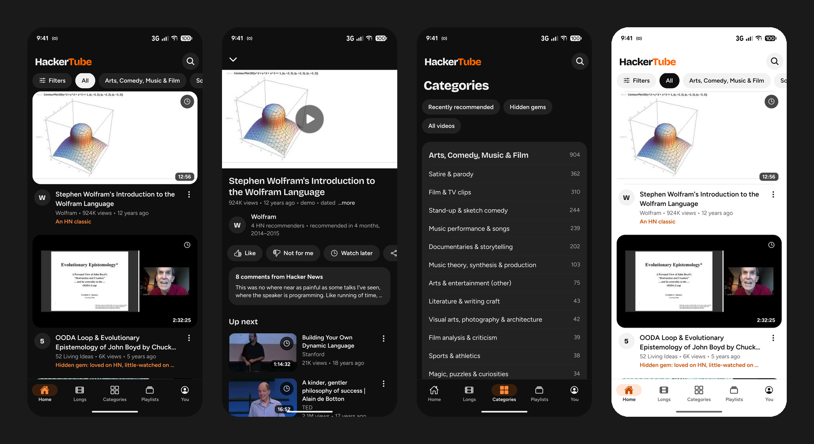
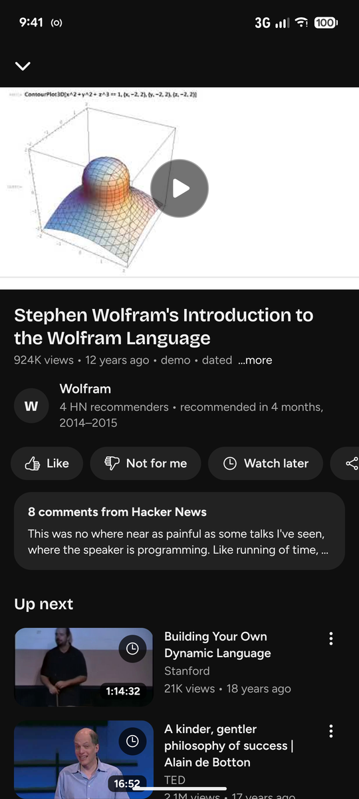
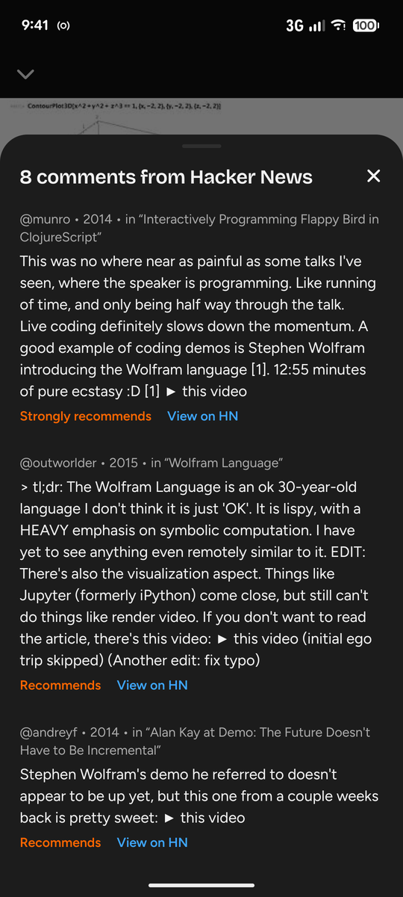
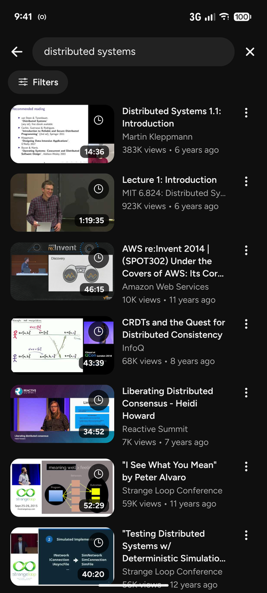
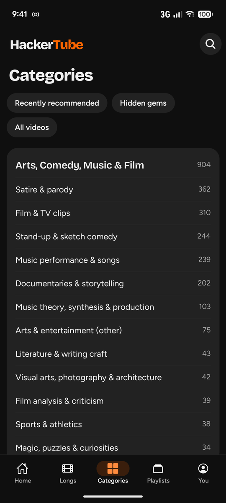
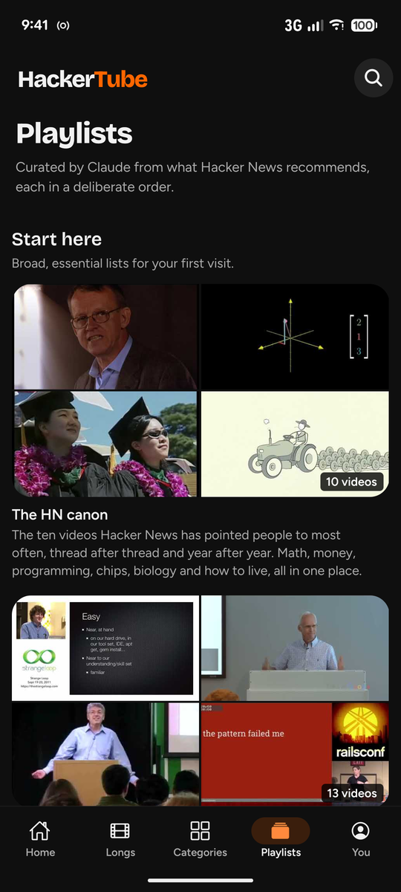

# HackerTube for Android and iOS

An unofficial, open source mobile app for [hackertube.org](https://hackertube.org): the YouTube videos that Hacker
News keeps telling each other to watch. 6,454 videos, 39,834 HN comments, 27 playlists, and a YouTube-style interface
for phones and tablets.

- No accounts and no tracking. Likes, saves and history stay on your device.
- Everything except video playback works offline, including search.
- No autoplay, and the player closes when a video ends, so YouTube's suggestion wall never appears.

Not made by or affiliated with hackertube.org, YouTube, Google, Hacker News or Y Combinator.

## Screenshots

Taken on a Pixel 7 in the default dark theme.

| Home | Video page | Comments from HN |
| :---: | :---: | :---: |
|  |  |  |

| Search | Categories | Playlists |
| :---: | :---: | :---: |
|  |  |  |

| Light theme | In motion |
| :---: | :---: |
|  |  |

## Install on Android

Download the APK from the latest [release](https://github.com/arguswaikhom/hackertube/releases/latest) and open it.
Android asks you to allow installs from your browser the first time. When a newer version is out, the app tells you
on launch, downloads it for you and opens Android's installer. Updates keep your likes and history.

## Build it

You need Node 22+, and for Android the Android SDK with JDK 17+. iOS builds need a Mac with Xcode.

    npm install
    npx expo run:android      # or: npx expo run:ios

`android/` and `ios/` are generated by `npx expo prebuild`. Don't edit them; configure through `app.json`.

**Building Android on Windows:** the native build writes very long paths. Install a newer CMake with the SDK manager
(`cmake;3.31.6`), add `cmake.dir=<sdk>/cmake/3.31.6` to `android/local.properties`, and build from a short folder such
as `C:\w\a`.

## Develop

    npm test              # feed, filter and search logic
    npx tsc --noEmit

Picking this up? Read [docs/STATUS.md](docs/STATUS.md), then [docs/DECISIONS.md](docs/DECISIONS.md),
[docs/PARITY.md](docs/PARITY.md) and [docs/ARCHITECTURE.md](docs/ARCHITECTURE.md).

## Data

The catalogue is built into the app from hackertube.org's public data export. Needs Python with `numpy` and
`fastembed`:

    # download and unzip https://hackertube.org/download/hackertube-data.zip, then:
    python scripts/fetch_playlists.py       # rarely; see docs/DECISIONS.md D8
    python scripts/build_catalog.py <unzipped folder>

Then bump `CATALOG` in `src/app/_layout.tsx` so installed apps copy the new file, and regenerate `data/vids.txt`.

Video lengths, view counts and upload dates come from the YouTube Data API. YouTube's terms don't allow shipping them
in the app, so a weekly GitHub Action refreshes a small file that the app downloads (see D5). To run it in a fork, add
a `YOUTUBE_API_KEY` repository secret, enable GitHub Pages with GitHub Actions as the source, and point
`expo.extra.metaUrl` in `app.json` at your Pages URL. For local runs, copy `.env.example` to `.env`. Never commit the
key or put it in the app.

## Releases

Pushing a tag like `v1.2.0` runs `.github/workflows/android-release.yml`: it builds the APK, signs it, and publishes a
GitHub Release, which the installed apps then see. The tag sets the version, so there's nothing to bump by hand. To
release from a fork, add three repository secrets for your own signing key: `ANDROID_KEYSTORE_BASE64` (the keystore,
base64-encoded), `ANDROID_KEYSTORE_PASSWORD` and `ANDROID_KEY_ALIAS`, and change `releasesUrl` in `app.json`.

## License

Code: [MIT](LICENSE). Data: from [hackertube.org](https://hackertube.org) and
[open-index/hacker-news](https://huggingface.co/datasets/open-index/hacker-news), under
[ODC-By 1.0](https://opendatacommons.org/licenses/by/1-0/). Keep the attribution in the About screen. HN comments remain
the work of their authors, and the summaries and labels were written by AI.
